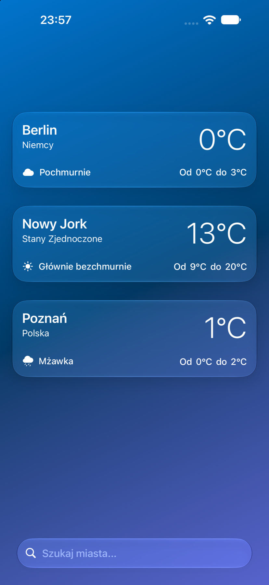
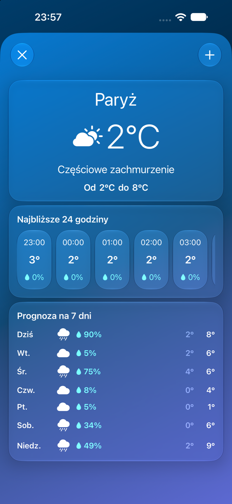
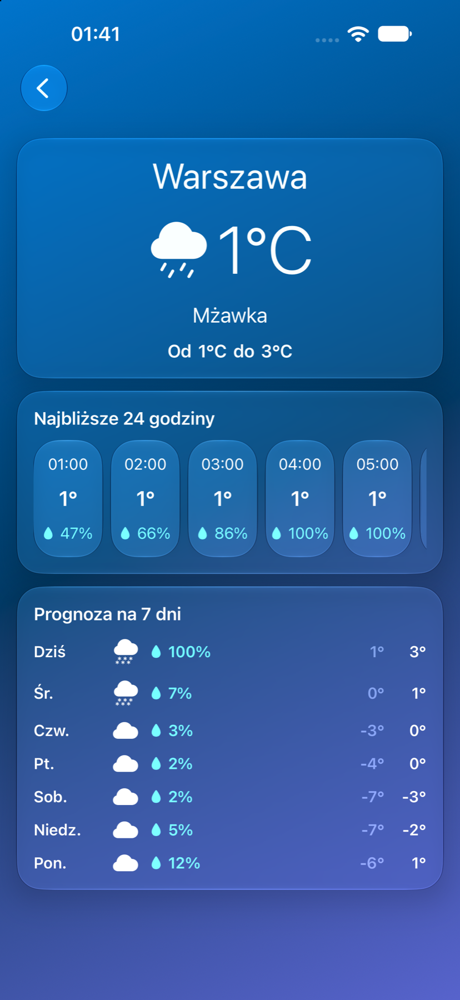
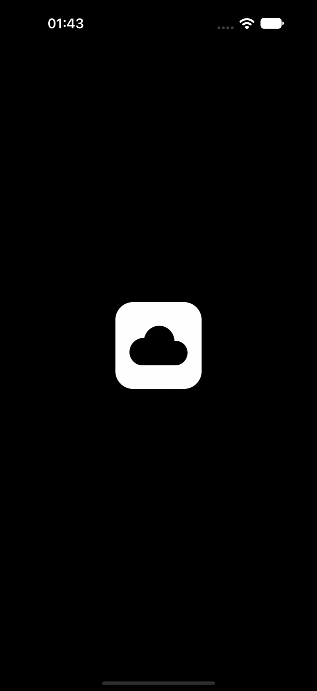
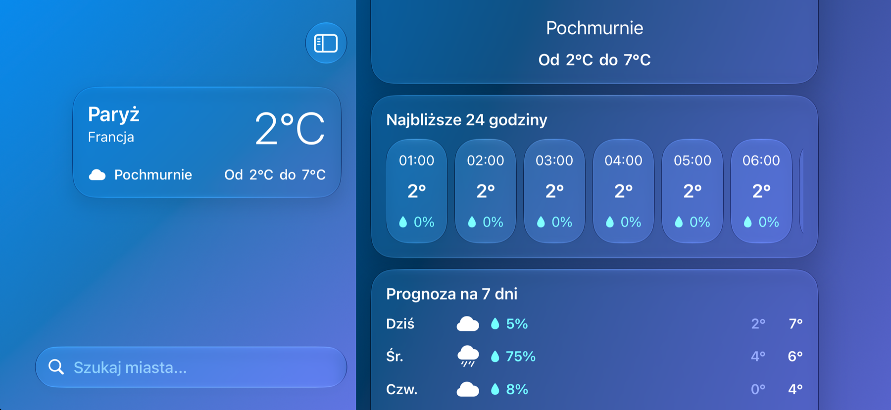
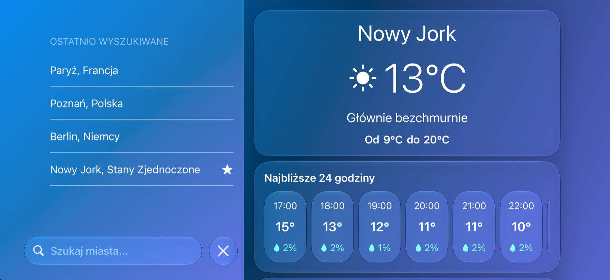

# Weatherly

Weatherly is an iOS weather app built with SwiftUI. It lets you search for cities around the world, save favorites, revisit recent searches, and view current conditions and forecasts.

### Screenshots

<table align="center">
  <tr>
    <td></td>
    <td></td>
    <td></td>
    <td></td>
  </tr>
  <tr>
    <td valign="middle">
      
    </td>
    <td colspan="3">
      <p></p>
      <p></p>
    </td>
  </tr>
</table>

## Features

- Search worldwide city results with validation for letters, Polish characters, spaces, and hyphens.
- Save cities to favorites and remove them with a swipe action.
- Keep recent searches and favorites between app launches with SwiftData.
- View current temperature and conditions, a 24-hour forecast, and a 7-day forecast.
- Use push navigation on compact layouts and a split view on wider layouts.
- Localized Polish and English interface.
- Support the system appearance, including Dark Mode.

## Technologies

- SwiftUI with a MVVM structure.
- SwiftData for local city persistence.
- FactoryKit for dependency registration and injection.
- A small networking layer built on `URLSession` and `async/await`.
- Swift Testing for unit tests.

## Weather data

Weatherly uses the [Open-Meteo Geocoding API](https://open-meteo.com/en/docs/geocoding-api) for city search and the [Open-Meteo Forecast API](https://open-meteo.com/en/docs) for forecasts. No API key is required.

## Requirements

- macOS with Xcode 26 or Xcode 27.
- An iOS 17 or newer simulator or device.
- XcodeGen to generate the Xcode project from `project.yml`.

Install XcodeGen with Homebrew if needed:

```sh
brew install xcodegen
```

## Build and run

```sh
git clone https://github.com/wspaleniak/Weatherly.git
cd Weatherly
xcodegen generate
open Weatherly.xcodeproj
```

In Xcode, select the `Weatherly` scheme and an iOS simulator or connected device, then run the app.

`project.yml` is the source of truth for the Xcode project. The generated `.xcodeproj` is ignored by Git, so run `xcodegen generate` after cloning and whenever the project configuration changes.

## Tests

Select an iOS Simulator in Xcode and choose **Product > Test**. The Swift Testing suite covers URL and API service behavior, stream publishing, view-model state and persistence logic, and weather timestamp formatting.

## Documentation

The generated DocC documentation is published on [GitHub Pages](https://wspaleniak.github.io/Weatherly/documentation/weatherly).
